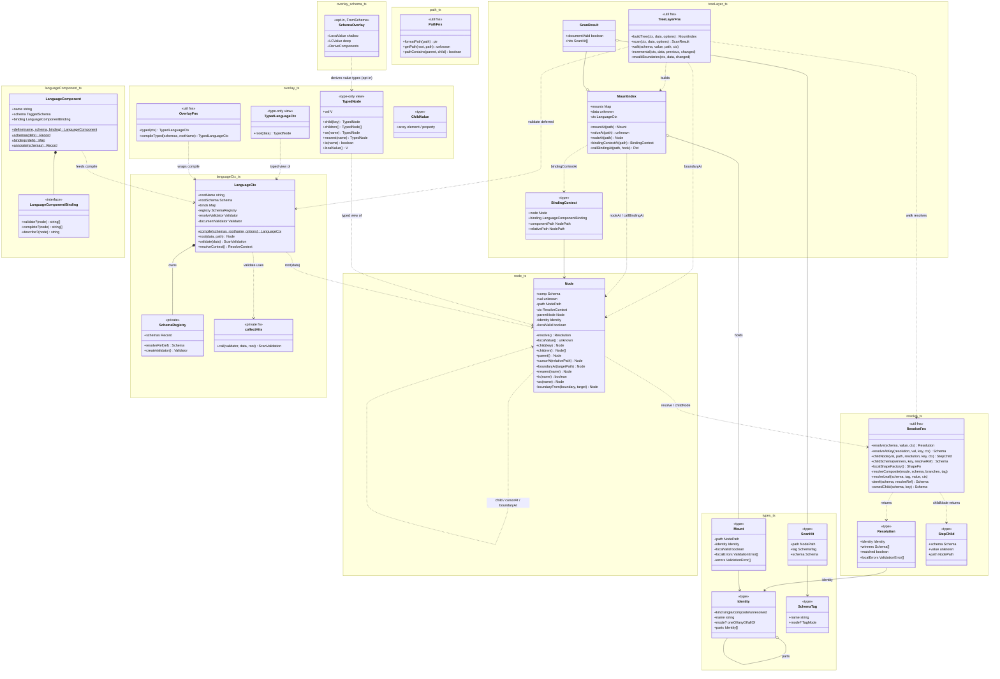
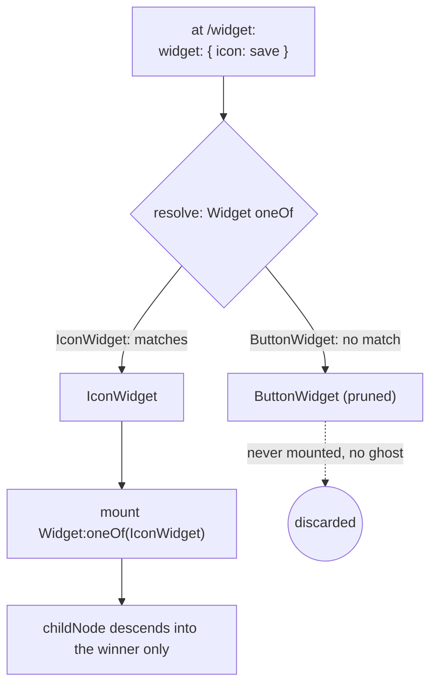

# Language Component Engine

This folder builds Appsemble-style DSL object identities from JSON Schema annotations, keeping
`jsonschema` as the validation engine while deriving a live object tree for validation, completion,
code actions, and editor tooling.

## Public surface (the barrel)

Everything re-exported from `index.ts`. The engine factors into a compiled context, a navigable
node, and stateless tree functions:

- **`LanguageComponent`** — declare components and collect them into registries (`define` /
  `schemas` / `bindings` / `annotate`).
- **`LanguageCtx`** — a schema set compiled once (`LanguageCtx.compile(schemas, rootName)`), reused
  across every value and edit. Hands out `root(data)` nodes and owns the whole-document `validate`.
- **`Node`** — one navigable `(comp, val, path)` focus with `resolve`/`child`/`children`/`nearest`/
  `cursorAt`/`boundaryAt`/`is`/`as`.
- **`buildTree` / `scan`** — stateless functions over a `LanguageCtx` that produce the identity tree
  (`MountIndex`) and the combined `ScanResult`.

Each box below is grouped by its file (the namespaces). `<<util fns>>` / `<<private fn>>` are
module-level free functions (not classes — the decision core and the tree layer are free functions
for the perf guardrail); `<<private>>` is an internal class; `<<type>>` / `<<interface>>` are data
shapes; `$` marks a static method; `-` marks a private member.



## Engine

`LanguageCtx.compile(schemas, rootName)` compiles a schema set once — the registry, the two
validators, and the ref-cutoff cache are keyed on the schema set and never on the data. The value
enters later, so a per-keystroke re-analysis reuses every compiled artifact. Tree building and
document validation are separate operations:

```text
LanguageCtx.compile(schemas, rootName)   compile registry + validators + ref-cutoff cache once
  buildTree(ctx, data)     -> identity tree (walk only): mounts (a MountIndex)
  ctx.validate(data)       -> documentValid + errors (+ hits)
  scan(ctx, data)          -> both, combined (a ScanResult)
```

- The walk owns the whole tree. `resolve` is the single place a `oneOf`/`anyOf`/`allOf` is decided;
  it returns the identity at a node and the concrete winner schema(s). `childNode` (over
  `resolveAtKey`) then does the value/path/schema descent, so the walk, `Node`, and boundary-finding
  all step into a child identically and only ever descend winning branches — losing-branch ghosts
  are never mounted.
- `validate` produces `documentValid` and `errors` independently of the walk, so a caller runs it on
  its own cadence (an LSP computes diagnostics on idle, not per keystroke). Its `hits` are kept for
  tooling but do not drive the tree.
- Compile also runs a **distinguishability analysis**: per union, can ref-cut local matching always
  pick the right branch (a discriminator, or branches separable by top-level shape)? A union it
  can't prove sufficient escalates at runtime — `resolve` re-validates the colliding branches in
  full only when ref-cut matches more than one, so the fast path is untouched and only genuine
  collisions pay. The verdict doubles as a dialect-sanity lint (`ctx.distinguishabilityLint` /
  `distinguishabilityErrors`, severity by component label): two distinct labeled components that
  share a ref-cut shape are an `error`.
- The walk reaches everything Appsemble's OpenAPI 3.0 schemas can express. It cannot reach language
  components placed behind conditional/pattern applicators (`if`/`then`, `patternProperties`), which
  those schemas do not use; blocks are reached through the value-directed `dynamicChild` hook
  instead (see `BLOCKS.md`).

`resolve` is the single decision point, and losing branches leave no ghost. For a value at `/widget`
against `Widget = oneOf[ButtonWidget, IconWidget]`:



## Incremental re-analysis

After an edit, re-analyze by handing `buildTree` the previous tree and the changed data paths (an
LSP has these from its edit ranges):

```ts
const ctx = LanguageCtx.compile(schemas, 'AppDefinition');
let tree = buildTree(ctx, app);
// User edits app at /pages/0/blocks/2/parameters/title
tree = buildTree(ctx, app, {
  previous: tree,
  changed: [['pages', 0, 'blocks', 2, 'parameters', 'title']],
});
```

Only the subtree enclosing each changed path (from its nearest `$ref` boundary, found by
`Node.boundaryAt`) is re-walked; the rest of the tree is reused. On a ~2,300-object app a
single-leaf edit is ~9 ms versus a multi-second full build (see `PERFORMANCE.md`). No hashing or
diffing — the retained previous tree is the cache, and the caller supplies what changed.

A `scan` returns a `ScanResult`: a `MountIndex` (so `mountAt` looks a node up by path, `nodeAt`
navigates to any path) that also carries `documentValid` and the tooling-facing `hits`.

```ts
const result = scan(ctx, app);
// The Mount at that path, or undefined.
const mount = result.mountAt(['pages', 0, 'blocks', 2]);
// A navigable Node at any path (not only mount points).
const node = result.nodeAt(['pages', 0, 'blocks', 2]);
// Every candidate schema the validator reached (ScanHit[]), winners and losers.
const { hits } = result;
```

## Navigating a single node

`buildTree`/`scan` walk the whole document; a `Node` reads one node in context without materializing
a tree. `LanguageCtx.root(data)` roots one, then `child`/`parent`/`nearest`/`children`/`cursorAt`
move over value and schema together, each focus deriving its own `identity` and `localValid` from
the same `resolve` the walk uses. `is`/`as` narrow a node to a component by name.

```ts
const root = LanguageCtx.compile(schemas, 'AppDefinition').root(app);

const block = root.child('pages')?.child(0)?.child('blocks')?.child(2);
// Identity of the resolved node, e.g. { kind: 'single', name: 'Block' }.
const identity = block?.identity;
// Whether the value satisfies its own (ref-cut) schema.
const valid = block?.localValid;
// The enclosing page's node, found by climbing ancestors.
const page = block?.nearest('PageDefinition');
// A node for every owned key.
const fields = block?.children();
```

The eager `walk` deliberately does NOT mint a `Node` per document node (it steps over transient
frames — see `PERFORMANCE.md`). Nodes are minted only where navigation is needed: `root`,
`cursorAt`, `boundaryAt`, and `MountIndex.nodeAt`.

## Declaring components and behaviors

`LanguageComponent.define` declares a component — an identity name, its schema (auto-annotated), and
a `LanguageComponentBinding` of optional `validate`/`complete`/`describe` hooks.
`schemas`/`bindings` collect a def list into the two registries: the `name -> schema` set for
`LanguageCtx.compile`, and the `name -> binding` map for dispatching behavior by the identity a node
resolves to. Hooks run only after resolution and each receive the `Node`, so they read value,
schema, and surrounding context, and report what a schema cannot express.

```ts
const Email = LanguageComponent.define(
  'Email',
  { type: 'string', format: 'email' },
  {
    validate: (node) =>
      typeof node.val === 'string' && node.val.endsWith('@example.com')
        ? []
        : [{ message: 'must be an @example.com address' }],
    describe: () => 'Email address',
  },
);

// Collect the def list (one Email here, more in practice) into the two registries.
const schemas = LanguageComponent.schemas([Email]);
const bindings = LanguageComponent.bindings([Email]);

// Dispatch a resolved node's behavior by its identity name.
const node = LanguageCtx.compile(schemas, 'Email').root('a@other.com');
// Returns [{ message: 'must be an @example.com address' }] — a Diagnostic, path omitted = on this node.
bindings.get(node.identity!.name)?.validate?.(node, {});
```

Passing the bindings to `compile` (via `CompileOptions.binds`) lets a `MountIndex` dispatch them by
location: `callBindingAt(path, 'complete')` finds the nearest enclosing component at `path` and runs
that hook on its node.

## Annotation

Identity comes only from `appsembleLanguageComponent`; a schema graph carrying no such tags produces
an empty tree. Wrappers and leaves can both be tagged:

```ts
const Widget = {
  appsembleLanguageComponent: { name: 'Widget', mode: 'oneOf' },
  oneOf: [
    { $ref: '#/components/schemas/ButtonWidget' },
    { $ref: '#/components/schemas/IconWidget' },
  ],
};
```

The shipped Appsemble schemas carry no such tags. To use the engine against them, tag the registry
with `LanguageComponent.annotate` (each named object/combinator schema becomes a language component;
scalars and already-tagged schemas pass through), then compile pinning the root component:

```ts
import { LanguageComponent, LanguageCtx, scan } from '@appsemble/lang-sdk';
import * as rawSchemas from '@appsemble/lang-sdk/schemas';

const schemas = LanguageComponent.annotate(rawSchemas as Record<string, Schema>);
const ctx = LanguageCtx.compile(schemas, 'AppDefinition');
// Mounts / -> AppDefinition, /pages/0 -> PageDefinition, ...
scan(ctx, app);
```

Untagged combinators are still transparent — an anonymous `oneOf`/`anyOf`/`allOf` surfaces the
identities of its tagged branches — but an untagged plain object mounts nothing, which is why the
named object schemas need tagging. The tag always lives under the `COMPONENT_KEY` keyword
(`appsembleLanguageComponent`), declared on the `jsonschema` `Schema` type by the module
augmentation in `types.ts`.

## Files

- `resolve.ts`: the decision core — `resolve` (combinator discrimination, one arm per combinator),
  `resolveAtKey`/`childSchema` (structural descent plus the value-directed `dynamicChild` hook), the
  shared `childNode` step, and the ref-cutoff (`localShapeFactory`). Free functions, shared by the
  walk and `Node` so identity is decided in exactly one place (and the walk stays allocation-free).
- `languageCtx.ts`: `LanguageCtx` — the compiled, value-independent memo (`compile`, `root`,
  `validate`, `resolveContext`).
- `node.ts`: `Node` — a parent-linked `(comp, val, path)` focus that shares `resolve`/`childNode`
  with the walk, for navigating and reading a single node in context.
- `treeLayer.ts`: the stateless tree functions — `buildTree`/`scan` and incremental re-analysis —
  plus `MountIndex` (the queryable/dispatch surface) and `ScanResult`.
- `languageComponent.ts`: the `LanguageComponent` class (`define` / `schemas` / `bindings` /
  `annotate` statics) and the `LanguageComponentBinding` type.
- `types.ts`: `Identity`, `Mount`, `ScanHit`, `SchemaTag`, `TaggedSchema`,
  `COMPONENT_KEY`/`schemaTag`/`isTagged`, and the `jsonschema` `Schema` augmentation.
- `path.ts`: JSON Pointer-safe path formatting and lookup — internal plumbing behind
  `MountIndex.mountAt` and the walk.
- `schemaRegistry.ts`: synchronous schema registry for `$ref` resolution.

## Optional type overlay (Tier-2)

`overlay.ts` is a typed VIEW over the runtime cursor: `import type` plus one boundary cast, zero
runtime, and no json-schema dependency. A consumer brings a `Components` registry (component name ->
value type) and the value types themselves — hand-written lang-sdk interfaces (natively recursive,
so cyclic components need no `Omit`) or types derived from `const` schemas. `TypedNode<V, C>` slices
the value type `V` by array-aware indexed access (`child`) and narrows by registry lookup
(`as`/`nearest`/`is`); `compileTyped`/`typed` are the entrypoints. It stays finite over deeply
recursive component graphs precisely because it never transforms a schema type internally — a
recursive interface is already tied off nominally, whereas re-deriving that shape from schema
literals inside a recursive cursor surface over-instantiates (TS2589).

`overlay-schema.ts` is the opt-in `FromSchema` derivation
(`LocalValue`/`LCValue`/`DeriveComponents`) for consumers who want value types generated from
`const` schema literals. It is the only part that touches the published
`@ngruychev/json-schema-to-ts` fork's `ignoreRefSiblings` option (draft-07), and it is a deep import
— the barrel never pulls it in, so the overlay's recursion-safety is unconditional. The runtime
engine is untouched throughout.

## Identity

```text
single: a single concrete language component
oneOf:  exactly one candidate matches
anyOf:  every matching candidate becomes a composite
allOf:  every candidate matches and becomes a composite
```

Resolved shapes read as `Widget:oneOf(IconWidget)` or
`StoredText:allOf(Identified, Timestamped, TextWidget)`; ambiguous or failed algebra becomes
`unresolved(...)`. Local identity is kept separate from whole-document validity: a value can resolve
as `ExperimentalButton` while an outer `if`/`then` makes the document invalid, and the node carries
those errors.

## Constraints

- `$ref` resolution is synchronous; external/block schemas must be loaded first.
- Map keys use JSON Pointer escaping, never `path.join('.')`.
- Coverage is bounded by what the walk can navigate structurally: language components placed only
  behind conditional/pattern applicators (`if`/`then`, `patternProperties`) are not discovered. The
  static Appsemble OpenAPI 3.0 schemas cannot express those. The one practical `if`/`then` case is
  the LSP's dynamically-assembled block schema; block params are reached through the value-directed
  `dynamicChild` resolver instead of the walk (see `BLOCKS.md`).

## See also

- [`BLOCKS.md`](./BLOCKS.md): mounting block parameters that live in per-block manifest schemas.
- [`PERFORMANCE.md`](./PERFORMANCE.md): where the time goes and how incremental re-analysis wins.
- [`./stress-test-schemas/README.md`](./stress-test-schemas/README.md): the stress-test suite for
  the walk.

```

```
