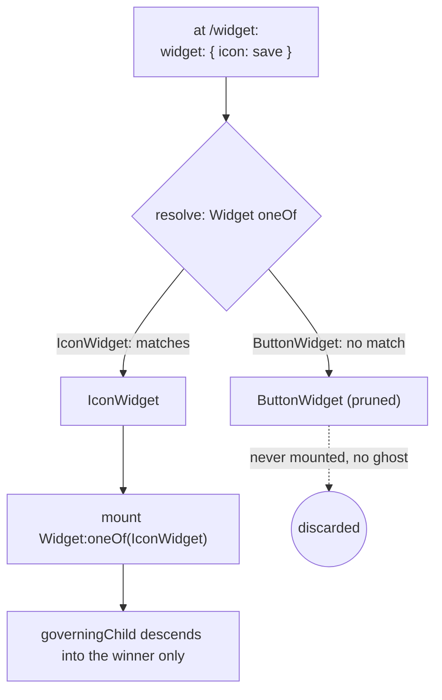

# Language Component Engine

This folder builds Appsemble-style DSL object identities from JSON Schema annotations, keeping
`jsonschema` as the validation engine while deriving a live object tree for validation, completion,
code actions, and editor tooling.

## Engine

`Scanner` compiles a schema set once and drives every analysis. Tree building and document
validation are separate operations:

```text
new Scanner(schemas)          compile registry + validators + ref-cutoff cache once
  .buildTree(data, rootSchema)     -> identity tree (walk only): interpretations
  .validate(data, rootSchema)      -> documentValid + errors (+ hits)
  .scan(data, rootSchema)       -> both, combined (the original result shape)
```

`scanComponents(data, rootSchema, schemas)` is a one-shot convenience equal to
`new Scanner(schemas).scan(...)`.

- The walk owns the whole tree. `resolve` is the single place a `oneOf`/`anyOf`/`allOf` is decided;
  it returns the identity at a node and the concrete winner schema(s). `governingChild` then does
  pure structural lookup on those winners, so navigation only ever descends winning branches and
  never re-validates — losing-branch ghosts are never mounted.
- `validate` produces `documentValid` and `errors` independently of the walk, so a caller runs it on
  its own cadence. Its `hits` are kept for tooling but do not drive the tree.
- The walk reaches everything Appsemble's OpenAPI 3.0 schemas can express. It cannot reach language
  components placed behind conditional/pattern applicators (`if`/`then`, `patternProperties`), which
  those schemas do not support; if they ever appear, a walk-driven local probe would cover them (see
  `PERFORMANCE.md`).

`resolve` is the single decision point, and losing branches leave no ghost. For a value at `/widget`
against `Widget = oneOf[ButtonWidget, IconWidget]`:



## Incremental re-analysis

After an edit, re-analyze by handing `buildTree` the previous tree and the changed data paths (an
LSP has these from its edit ranges):

```ts
const analyzer = new Scanner(schemas);
let tree = analyzer.buildTree(app, rootSchema);
// User edits app at /pages/0/blocks/2/parameters/title
tree = analyzer.buildTree(app, rootSchema, {
  previous: tree,
  changed: [['pages', 0, 'blocks', 2, 'parameters', 'title']],
});
```

Only the subtree enclosing each changed path (from its nearest `$ref` boundary) is re-walked; the
rest of the tree is reused. On a ~2,300-object app a single-leaf edit is ~37 ms versus ~3.1 s for a
full build (see `PERFORMANCE.md`). No hashing or diffing — the retained previous tree is the cache,
and the caller supplies what changed.

## Annotation

Identity comes only from `appsembleLanguageComponent`; a schema graph carrying no such tags produces
an empty tree. Wrappers and leaves can both be tagged:

```ts
const Widget = {
  appsembleLanguageComponent: { name: 'Widget', mode: 'oneOf' },
  oneOf: [
    { $ref: '#/components/schemas/ButtonWidget' },
    { $ref: '#/components/schemas/IconWidget' },
  ],
};

const ButtonWidget = {
  appsembleLanguageComponent: { name: 'ButtonWidget', mode: 'single' },
  type: 'object',
  required: ['type', 'text'],
  properties: { type: { const: 'button' }, text: { type: 'string' } },
};
```

The shipped Appsemble schemas carry no such tags. To use the engine against them, tag the registry
with `annotateSchemas` (each named object/combinator schema becomes a language component; scalars
and already-tagged schemas pass through). `annotateSchema` tags a single schema.

```ts
import { annotateSchemas, Scanner } from '@appsemble/lang-sdk';
import * as rawSchemas from '@appsemble/lang-sdk/schemas';

const schemas = annotateSchemas(rawSchemas as Record<string, Schema>);
const analyzer = new Scanner(schemas);
// Mounts / -> AppDefinition, /pages/0 -> PageDefinition, ...
analyzer.scan(app, schemas.AppDefinition);
```

Untagged combinators are still transparent — an anonymous `oneOf`/`anyOf`/`allOf` surfaces the
identities of its tagged branches — but an untagged plain object mounts nothing, which is why the
named object schemas above need tagging.

The keyword is configurable: `annotateSchemas(raw, key)` and `new Scanner(schemas, key)` both
default to `COMPONENT_KEY` (`appsembleLanguageComponent`) but accept any key, as long as the two
agree.

## Files

- `scanner.ts`: the engine — `Scanner` (`buildTree`/`validate`/`scan`), incremental re-analysis, and
  the `scanComponents()` one-shot convenience.
- `cursor.ts`: `Cursor` / `cursorAt`, a lazy zipper over `(value, schema)` that shares `resolve` and
  `governingChild` with the walk, for navigating and reading a single node in context.
- `binding.ts`: `defineLanguageComponent` plus `componentSchemas` / `componentBindings`, to declare
  a component's schema and behaviors and collect them into a registry.
- `annotate.ts`: `annotateSchema` / `annotateSchemas`, which tag object and combinator schemas so
  the analyzer mounts identities for them.
- `types.ts`: `Identity`, `Mount`, `ScanHit`, `SchemaTag`, `COMPONENT_KEY`/`schemaTag`, and the
  `jsonschema` `Schema` augmentation for `appsembleLanguageComponent`.
- `path.ts`: JSON Pointer-safe path formatting and lookup.
- `schemaRegistry.ts`: synchronous schema registry for `$ref` resolution.

## Identity

```text
single: a single concrete language component
oneOf:  exactly one candidate matches
anyOf:  every matching candidate becomes a composite
allOf:  every candidate matches and becomes a composite
```

Resolved shapes read as `Widget:oneOf(IconWidget)` or
`StoredText:allOf(Identified, Timestamped, TextWidget)`; ambiguous or failed algebra becomes
`unresolved(...)`. Local identity is kept separate from whole-document validity: a value can resolve
as `ExperimentalButton` while an outer `if`/`then` makes the document invalid, and the node carries
those errors.

## Constraints

- `$ref` resolution is synchronous; external/block schemas must be loaded first.
- Map keys use JSON Pointer escaping, never `path.join('.')`.
- Coverage is bounded by what the walk can navigate structurally: language components placed only
  behind conditional/pattern applicators (`if`/`then`, `patternProperties`) are not discovered.
  Appsemble's OpenAPI 3.0 schemas cannot express those, so this bound is not hit in practice.

## See also

- [`BLOCKS.md`](./BLOCKS.md): mounting block parameters that live in per-block manifest schemas.
- [`PERFORMANCE.md`](./PERFORMANCE.md): where the time goes and how incremental re-analysis wins.
- [`../mini-schemas/README.md`](../mini-schemas/README.md): the stress-test suite for the walk.
