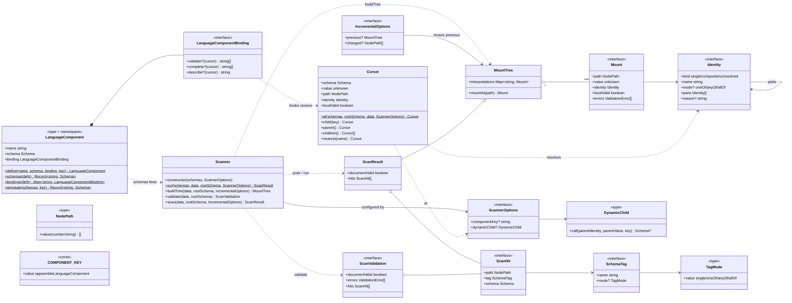
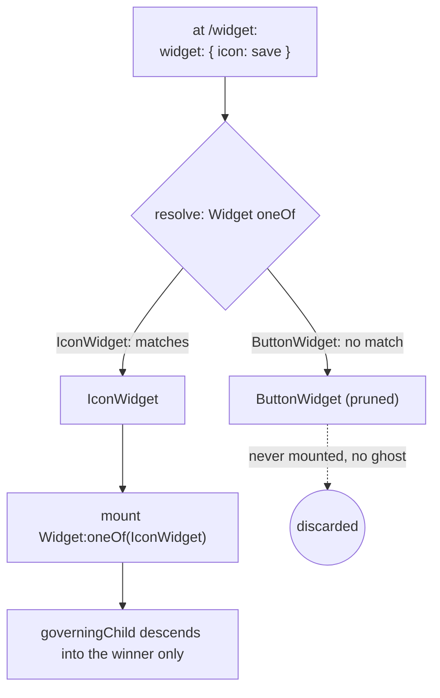

# Language Component Engine

This folder builds Appsemble-style DSL object identities from JSON Schema annotations, keeping
`jsonschema` as the validation engine while deriving a live object tree for validation, completion,
code actions, and editor tooling.

## Public surface (the barrel)

Everything re-exported from `index.ts`. Three nodes carry the surface: the `Scanner` and `Cursor`
classes and the `LanguageComponent` namespace (which is also the def _type_ — value and type share
one name); there are no free functions. The rest are the result shapes they produce (`MountTree` /
`ScanResult`, which carry `mountAt` for path lookup) and the config/data types. Stereotypes:
`<<interface>>` data shapes, `<<type>>` aliases, `<<const>>` values; `$` marks a static method.



## Engine

`Scanner` compiles a schema set once and drives every analysis. Tree building and document
validation are separate operations:

```text
new Scanner(schemas)          compile registry + validators + ref-cutoff cache once
  .buildTree(data, rootSchema)     -> identity tree (walk only): interpretations
  .validate(data, rootSchema)      -> documentValid + errors (+ hits)
  .scan(data, rootSchema)       -> both, combined (the original result shape)
```

`Scanner.run(schemas, data, rootSchema)` is a one-shot static equal to
`new Scanner(schemas).scan(data, rootSchema)`; construct and reuse a `Scanner` when analyzing
repeatedly so the registry, validator, and ref-cutoff cache compile once.

- The walk owns the whole tree. `resolve` is the single place a `oneOf`/`anyOf`/`allOf` is decided;
  it returns the identity at a node and the concrete winner schema(s). `governingChild` then does
  pure structural lookup on those winners, so navigation only ever descends winning branches and
  never re-validates — losing-branch ghosts are never mounted.
- `validate` produces `documentValid` and `errors` independently of the walk, so a caller runs it on
  its own cadence. Its `hits` are kept for tooling but do not drive the tree.
- The walk reaches everything Appsemble's OpenAPI 3.0 schemas can express. It cannot reach language
  components placed behind conditional/pattern applicators (`if`/`then`, `patternProperties`), which
  those schemas do not support; if they ever appear, a walk-driven local probe would cover them (see
  `PERFORMANCE.md`).

`resolve` is the single decision point, and losing branches leave no ghost. For a value at `/widget`
against `Widget = oneOf[ButtonWidget, IconWidget]`:



## Incremental re-analysis

After an edit, re-analyze by handing `buildTree` the previous tree and the changed data paths (an
LSP has these from its edit ranges):

```ts
const analyzer = new Scanner(schemas);
let tree = analyzer.buildTree(app, rootSchema);
// User edits app at /pages/0/blocks/2/parameters/title
tree = analyzer.buildTree(app, rootSchema, {
  previous: tree,
  changed: [['pages', 0, 'blocks', 2, 'parameters', 'title']],
});
```

Only the subtree enclosing each changed path (from its nearest `$ref` boundary) is re-walked; the
rest of the tree is reused. On a ~2,300-object app a single-leaf edit is ~37 ms versus ~3.1 s for a
full build (see `PERFORMANCE.md`). No hashing or diffing — the retained previous tree is the cache,
and the caller supplies what changed.

A `scan` returns a `ScanResult`: a `MountTree` (so `mountAt` looks a node up by path) that also
carries `documentValid` and the tooling-facing `hits`.

```ts
const result = new Scanner(schemas).scan(app, schemas.AppDefinition);
// The Mount at that path, or undefined.
const mount = result.mountAt(['pages', 0, 'blocks', 2]);
// Every candidate schema the validator reached (ScanHit[]), winners and losers.
const { hits } = result;
```

## Navigating a single node

`buildTree`/`scan` walk the whole document; `Cursor` reads one node in context without materializing
a tree. `Cursor.at` roots it, then `child`/`parent`/`nearest`/`children` move over value and schema
together, each focus deriving its own `identity` and `localValid` from the same `resolve` the walk
uses.

```ts
import { Cursor, LanguageComponent } from '@appsemble/lang-sdk';

const root = Cursor.at(schemas, schemas.AppDefinition, app);

const block = root.child('pages')?.child(0)?.child('blocks')?.child(2);
// Identity of the resolved node, e.g. { kind: 'single', name: 'Block' }.
const identity = block?.identity;
// Whether the value satisfies its own (ref-cut) schema.
const valid = block?.localValid;
// The enclosing page's cursor, found by climbing ancestors.
const page = block?.nearest('PageDefinition');
// A cursor for every owned key.
const fields = block?.children();
```

## Declaring components and behaviors

`LanguageComponent.define` declares a component — an identity name, its schema (auto-annotated), and
a `LanguageComponentBinding` of optional `validate`/`complete`/`describe` hooks.
`schemas`/`bindings` collect a def list into the two registries: the `name -> schema` set for
`Scanner`/`Cursor.at`, and the `name -> binding` map for dispatching behavior by the identity a node
resolves to. Hooks run only after resolution and each receive a `Cursor`, so they read value,
schema, and surrounding context, and report what a schema cannot express.

```ts
const Email = LanguageComponent.define(
  'Email',
  { type: 'string', format: 'email' },
  {
    validate: (cursor) =>
      typeof cursor.value === 'string' && cursor.value.endsWith('@example.com')
        ? []
        : ['must be an @example.com address'],
    describe: () => 'Email address',
  },
);

// Collect the def list (one Email here, more in practice) into the two registries.
const schemas = LanguageComponent.schemas([Email]);
const bindings = LanguageComponent.bindings([Email]);

// Dispatch a resolved node's behavior by its identity name.
const cursor = Cursor.at(schemas, schemas.Email, 'a@other.com');
// Returns ['must be an @example.com address'].
bindings.get(cursor.identity!.name)?.validate?.(cursor);
```

## Annotation

Identity comes only from `appsembleLanguageComponent`; a schema graph carrying no such tags produces
an empty tree. Wrappers and leaves can both be tagged:

```ts
const Widget = {
  appsembleLanguageComponent: { name: 'Widget', mode: 'oneOf' },
  oneOf: [
    { $ref: '#/components/schemas/ButtonWidget' },
    { $ref: '#/components/schemas/IconWidget' },
  ],
};

const ButtonWidget = {
  appsembleLanguageComponent: { name: 'ButtonWidget', mode: 'single' },
  type: 'object',
  required: ['type', 'text'],
  properties: { type: { const: 'button' }, text: { type: 'string' } },
};
```

The shipped Appsemble schemas carry no such tags. To use the engine against them, tag the registry
with `LanguageComponent.annotate` (each named object/combinator schema becomes a language component;
scalars and already-tagged schemas pass through).

```ts
import { LanguageComponent, Scanner } from '@appsemble/lang-sdk';
import * as rawSchemas from '@appsemble/lang-sdk/schemas';

const schemas = LanguageComponent.annotate(rawSchemas as Record<string, Schema>);
const analyzer = new Scanner(schemas);
// Mounts / -> AppDefinition, /pages/0 -> PageDefinition, ...
analyzer.scan(app, schemas.AppDefinition);
```

Untagged combinators are still transparent — an anonymous `oneOf`/`anyOf`/`allOf` surfaces the
identities of its tagged branches — but an untagged plain object mounts nothing, which is why the
named object schemas above need tagging.

The keyword is configurable: `LanguageComponent.annotate(raw, key)` and
`new Scanner(schemas, { componentKey })` both default to `COMPONENT_KEY`
(`appsembleLanguageComponent`) but accept any key, as long as the two agree.

## Files

- `scanner.ts`: the engine — `Scanner` (`buildTree`/`validate`/`scan` and the `run` one-shot
  static), incremental re-analysis.
- `cursor.ts`: `Cursor` (rooted via `Cursor.at`), a lazy zipper over `(value, schema)` that shares
  `resolve` and `governingChild` with the walk, for navigating and reading a single node in context.
- `binding.ts`: the `LanguageComponent` namespace (`define` / `schemas` / `bindings` / `annotate`)
  and the `LanguageComponentBinding` type, to declare a component's schema and behaviors and collect
  them into registries.
- `annotate.ts`: the schema-tagging internals behind `LanguageComponent.annotate` (object and
  combinator schemas get tagged so the analyzer mounts identities for them).
- `types.ts`: `Identity`, `Mount`, `ScanHit`, `SchemaTag`, `COMPONENT_KEY`/`schemaTag`, and the
  `jsonschema` `Schema` augmentation for `appsembleLanguageComponent`.
- `path.ts`: JSON Pointer-safe path formatting and lookup — internal plumbing behind
  `MountTree.mountAt` and the walk; not part of the barrel.
- `schemaRegistry.ts`: synchronous schema registry for `$ref` resolution.

## Identity

```text
single: a single concrete language component
oneOf:  exactly one candidate matches
anyOf:  every matching candidate becomes a composite
allOf:  every candidate matches and becomes a composite
```

Resolved shapes read as `Widget:oneOf(IconWidget)` or
`StoredText:allOf(Identified, Timestamped, TextWidget)`; ambiguous or failed algebra becomes
`unresolved(...)`. Local identity is kept separate from whole-document validity: a value can resolve
as `ExperimentalButton` while an outer `if`/`then` makes the document invalid, and the node carries
those errors.

## Constraints

- `$ref` resolution is synchronous; external/block schemas must be loaded first.
- Map keys use JSON Pointer escaping, never `path.join('.')`.
- Coverage is bounded by what the walk can navigate structurally: language components placed only
  behind conditional/pattern applicators (`if`/`then`, `patternProperties`) are not discovered. The
  static Appsemble OpenAPI 3.0 schemas cannot express those. The one practical `if`/`then` case is
  the LSP's dynamically-assembled block schema; block params are reached through the value-directed
  `dynamicChild` resolver instead of the walk (see `BLOCKS.md`), so the bound is not hit there
  either.

## See also

- [`BLOCKS.md`](./BLOCKS.md): mounting block parameters that live in per-block manifest schemas.
- [`PERFORMANCE.md`](./PERFORMANCE.md): where the time goes and how incremental re-analysis wins.
- [`./stress-test-schemas/README.md`](./stress-test-schemas/README.md): the stress-test suite for
  the walk.
