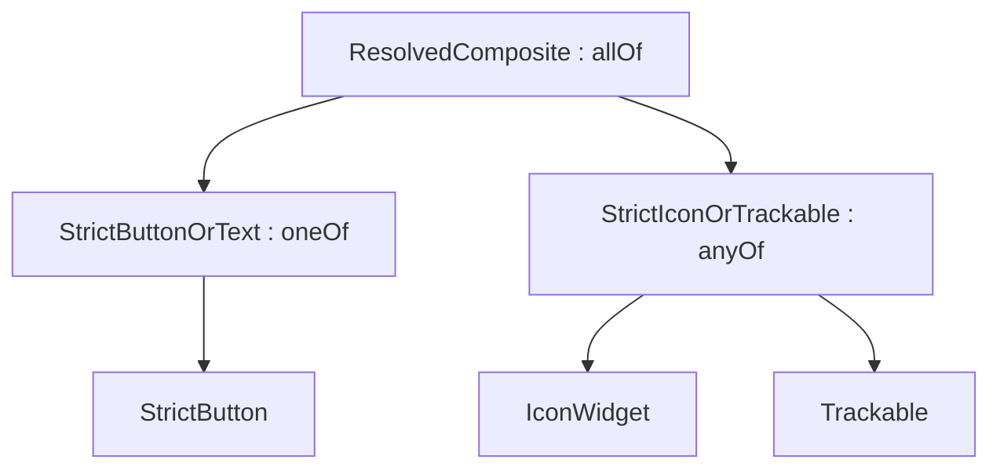

# Stress-test schemas

This folder is a stress-test suite for the parent `language-component` engine.

It defines a tiny annotated JSON Schema DSL (`schemas.ts`) shaped as a small Appsemble app —
`AppDefinition` owns pages, a page owns blocks, and each block's `parameters` schema is resolved by
`type@version` through a block manifest (the `dynamicChild` hook in `harness.ts`), so no parameter
union is ever walked. Around that happy path sit the probe components: `oneOf`/`anyOf`/`allOf`,
nested same-path algebra, invalid local matches, local-vs-document validity, losing-branch ghosts,
and conditional placement the walk cannot navigate.

It consumes the engine **only through the parent barrel** (`../index.js`), never a deep import into
an internal module, so it exercises the same public surface a real consumer sees.

Run the suite with:

```sh
npx vitest run packages/lang-sdk/language-component/stress-test-schemas
```

## Where the scenarios live

`scenarios.ts` is the single source of truth, in two tables. Each entry pairs a document with the
identity mounted at every JSON Pointer and whether the document validates, and carries a one-line
`doc` of what it proves. `baseline.test.ts` asserts both tables, so the expected output sits next to
the input that produces it and cannot drift from a separate description.

- `appScenarios` walk a whole tiny app (pages → blocks → resolver-supplied parameters), proving the
  happy path end to end.
- `componentScenarios` isolate one component as its own root (`root` names the registry key),
  proving each ambiguous, duplicate, losing-branch, ancestor-error, conditional, and production-gate
  probe on the smallest schema that exhibits it rather than buried in the app shape.

The other test files add what an identity map alone does not show:

- `edge-cases.test.ts`: ref-cutoff local validation, untagged combinators with no annotated parts,
  incremental boundaries, and node navigation.
- `capabilities.test.ts`: walk behavior the validator diverges from — a child mounted under a
  short-circuited `anyOf` branch, and a component behind `if`/`then` the walk cannot reach.
- `incremental.test.ts`: an incremental `buildTree` matches a full build after each edit deep in the
  app, and reuses untouched mounts by reference.

## Nested composite identity

A single value can resolve to one nested composite identity — the algebra of the `allOf` / `oneOf` /
`anyOf` at that path, not a tree of separately mounted nodes. The `resolvedComposite` scenario
resolves to:


