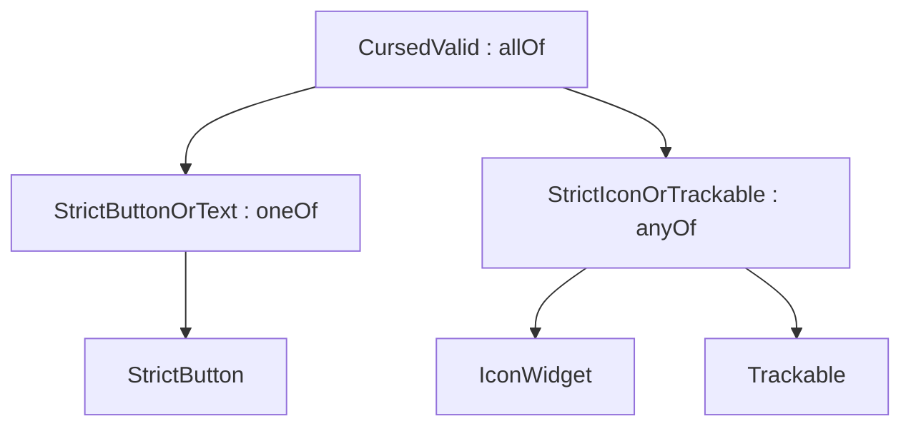

# Stress-test schemas

This folder is a stress-test suite for the parent `language-component` engine.

It defines a tiny annotated JSON Schema DSL plus sample data that exercise normal objects,
`oneOf`/`anyOf`/`allOf`, nested same-path algebra, invalid local matches, local-vs-document
validity, losing-branch ghosts, and conditional placement the walk cannot navigate.

It consumes the engine **only through the parent barrel** (`../index.js`), never a deep import into
an internal module, so it exercises the same public surface a real consumer sees.

Run the suite with:

```sh
npx vitest run packages/lang-sdk/language-component/stress-test-schemas
```

## What it proves

- identity comes from resolving the entry schema, not from hit order
- `oneOf`/`anyOf`/`allOf` resolve to single or composite objects
- ambiguous or unmatched algebra stays `unresolved` instead of guessing
- local object identity is kept separate from whole-document validity
- a child of a losing combinator branch is not mounted (no ghosts)
- a language component behind an applicator the walk cannot navigate (`if`/`then`) is not mounted

## Test files

- `baseline.test.ts`: the baseline scenarios below.
- `edge-cases.test.ts`: the design gaps (ghost, untagged combinator, hit order, ancestor errors) and
  a catalog of latent ones.
- `incremental.test.ts`: incremental re-analysis fidelity — an incremental `buildTree` matches a
  full build after each change.
- `capabilities.test.ts`: walk behavior for `anyOf` short-circuit children and `if`/`then`
  placement.

## Baseline scenarios

Each scenario is analyzed as its own document, so `---` separates independently analyzed inputs. A
mounted node's comment is `# <JSON Pointer> -> <identity>`; the top-level `environment` scalar never
mounts.

```yaml
# normal — one document, every algebra kind
environment: development
widget: # /widget -> Widget:oneOf(IconWidget)
  icon: save
flexible: # /flexible -> FlexibleThing:anyOf(TextWidget, IconWidget)
  text: hello
  icon: star
composed: # /composed -> StoredText:allOf(Identified, Timestamped, TextWidget)
  id: abc
  createdAt: 2026-06-26
  text: hello
scaryWidget: # /scaryWidget -> ScaryWidget:oneOf(ExperimentalButton)
  type: button
  experimental: true
---
# scaryProduction — documentValid: false; local identity is kept, the document is invalid
environment: production
scaryWidget: # /scaryWidget -> ScaryWidget:oneOf(ExperimentalButton)
  type: button
  experimental: true # error: does not exactly match expected constant: false
---
# scaryProductionFixed — documentValid: true
environment: production
scaryWidget: # /scaryWidget -> ScaryWidget:oneOf(StandardButton)
  type: button
  experimental: false
---
# cursedA — two oneOf branches match, so it stays unresolved rather than guessing
cursedA: # /cursedA -> unresolved(oneOf ... got 2) [ButtonWidget, TextAndIcon:allOf(TextWidget, IconWidget)]
  type: button
  text: hello
  icon: star
---
# cursedB — an allOf part is itself ambiguous
cursedB: # /cursedB -> unresolved(allOf did not fully match) [unresolved(oneOf ... got 2) [ButtonWidget, TextWidget], IconOrTrackable:anyOf(IconWidget, Trackable)]
  type: button
  text: hello
  icon: star
  analytics: true
---
# ghost — indistinguishable branches
ghostWidget: # /ghostWidget -> unresolved(oneOf ... got 2) [StandardGhostButton, ExperimentalGhostButton]
  type: button
---
# invalidLocal — no branch matches
widget: # /widget -> unresolved(oneOf ... got 0) []
  type: button
---
# cursedValid — nested same-path algebra resolves when inner branches are distinguishable
cursedValid: # /cursedValid -> CursedValid:allOf(StrictButtonOrText:oneOf(StrictButton), StrictIconOrTrackable:anyOf(IconWidget, Trackable))
  kind: button
  text: hello
  icon: star
  analytics: true
```

A single value at `/cursedValid` resolves to one nested composite identity — the algebra of the
`allOf` / `oneOf` / `anyOf` at that path, not a tree of separately mounted nodes:



## Gap and capability cases

```yaml
# ghostChild — a losing oneOf branch leaves no ghost
ghostHost: # /ghostHost -> GhostHost:oneOf(PlainBranch)
  type: plain
  action: # not mounted — FancyBranch lost, so its `action` child never mounts
    kind: noop
---
# untaggedComposite — an untagged allOf is transparent, surfacing its tagged parts
untaggedComposite: # /untaggedComposite -> allOf(StrictButtonOrText:oneOf(StrictButton), ...)
  kind: button
  text: hello
  icon: star
  analytics: true
---
# ancestorError — the ancestor holds the error, the valid child does not
container: # /container carries the missing-`label` error
  inner: # /container/inner carries no error
    ok: true
---
# host — the walk mounts a child under a non-first anyOf branch the validator short-circuits past
host:
  badge: # /host/badge -> Badge
    label: gold
  text: hi
---
# condHost — a component only behind if/then is not mounted (the walk cannot navigate it)
condHost:
  mode: fancy
  trinket: # /condHost/trinket -> not mounted (if/then is outside walk coverage)
    gem: ruby
```
